# Expo SNS App

React Native (Expo) で作った SNS 風モバイルアプリ。投稿の作成・編集・削除、ユーザー認証、検索、イベントページなどの機能を備えている。

## デモ


- ログインユーザー自身の投稿のみ編集できる

※ デザインを若干変更したので上の gif 画像と現行のものに違いがあるが、機能は基本的に同じ。下記の画像の方が最新に近いデザイン。

## 主な使用技術

- Node.js 16.18.1
- NativeBase
- TypeScript
- React Native (Expo CLI)
- Firebase
- Redux

| 技術 | バージョン |
|------|-----------|
| NativeBase | 3.4.0 |
| Expo | 47.0.0 |
| Firebase | 9.14.0 |
| react-redux | 8.0.5 |

## スクリーンショット

### Feed

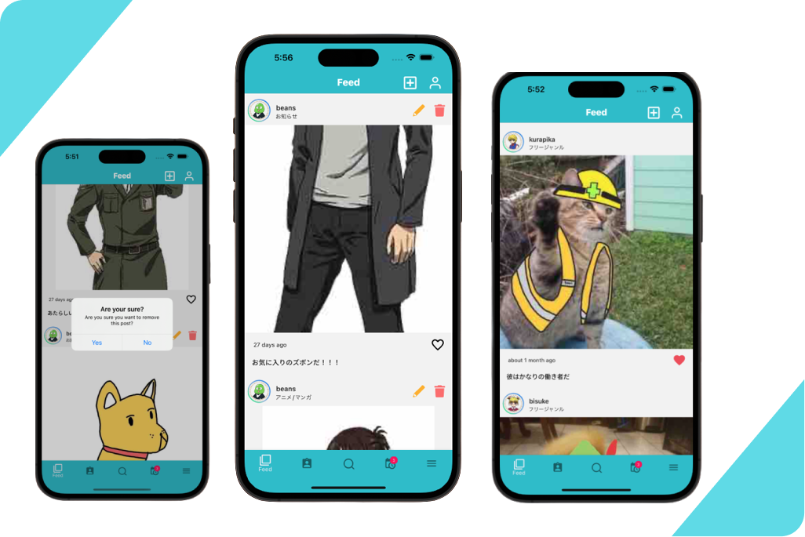

複数枚投稿を前提に最初はデザインしていたが、Expo CLI の範囲内では現状厳しいことが判明したため、このような仕様になっている。

### Creator Page

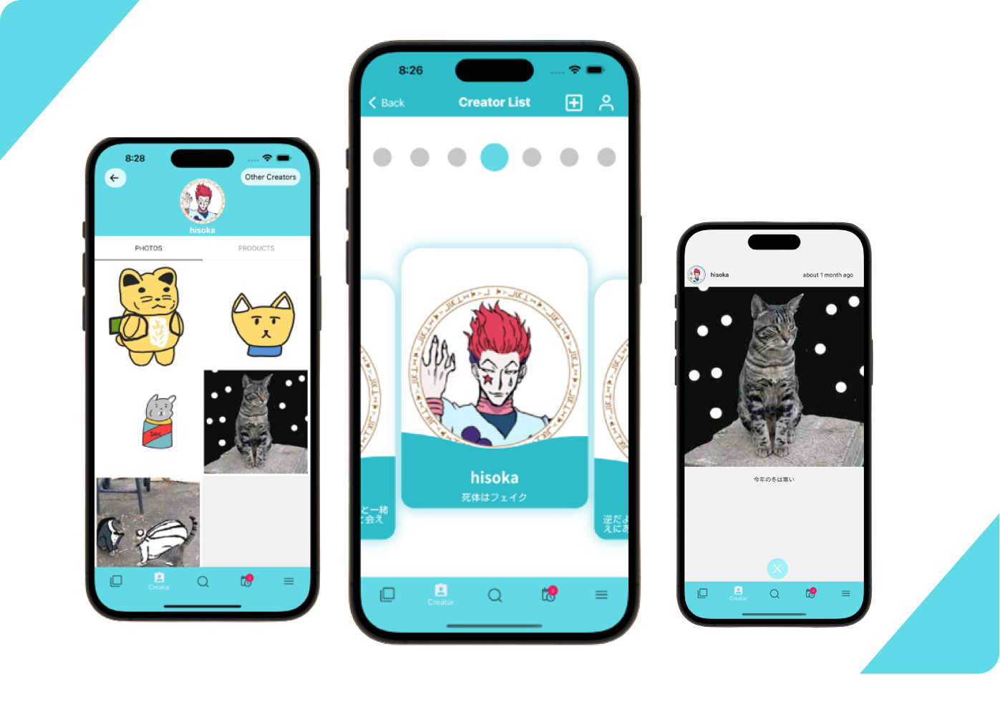

### Event Page

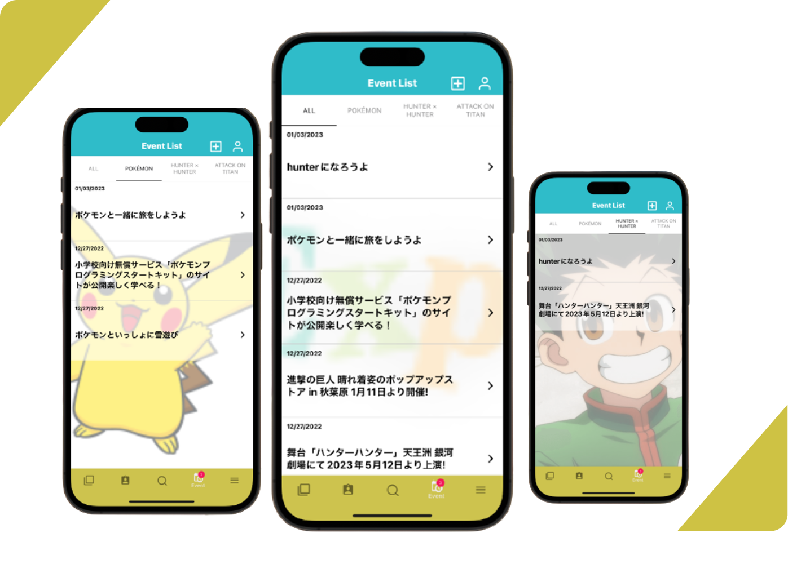

### Create

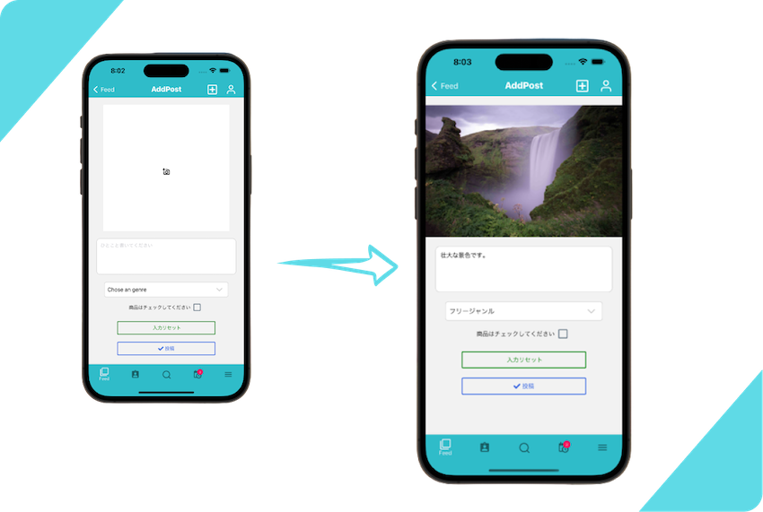

### Edit Post

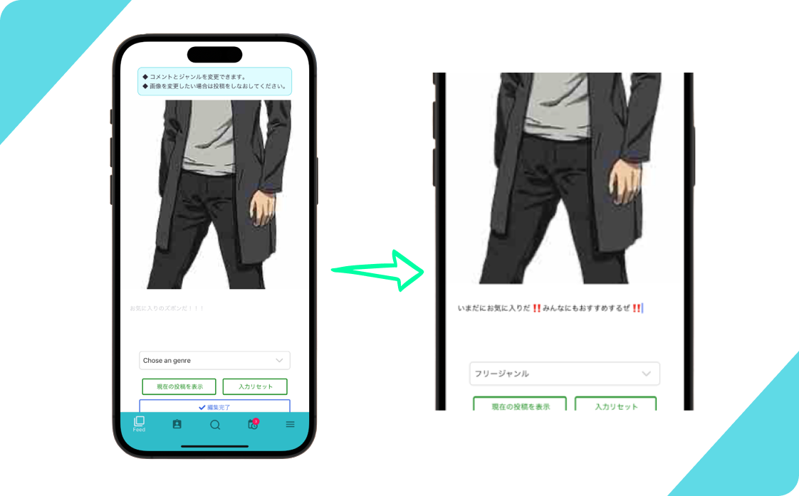

### Edit Profile

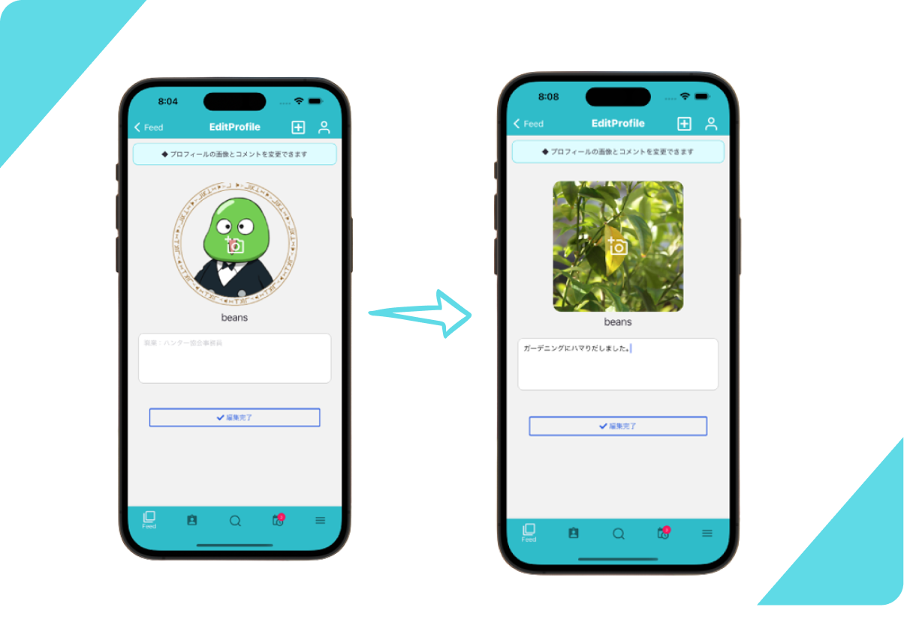

### Search Page

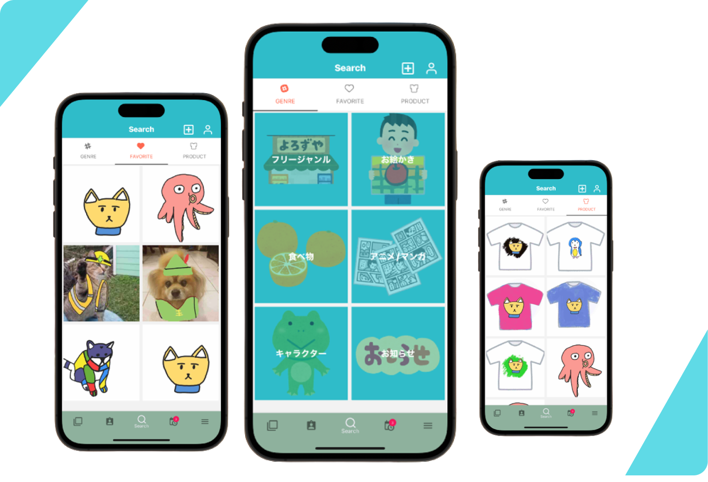

### Sign up / in

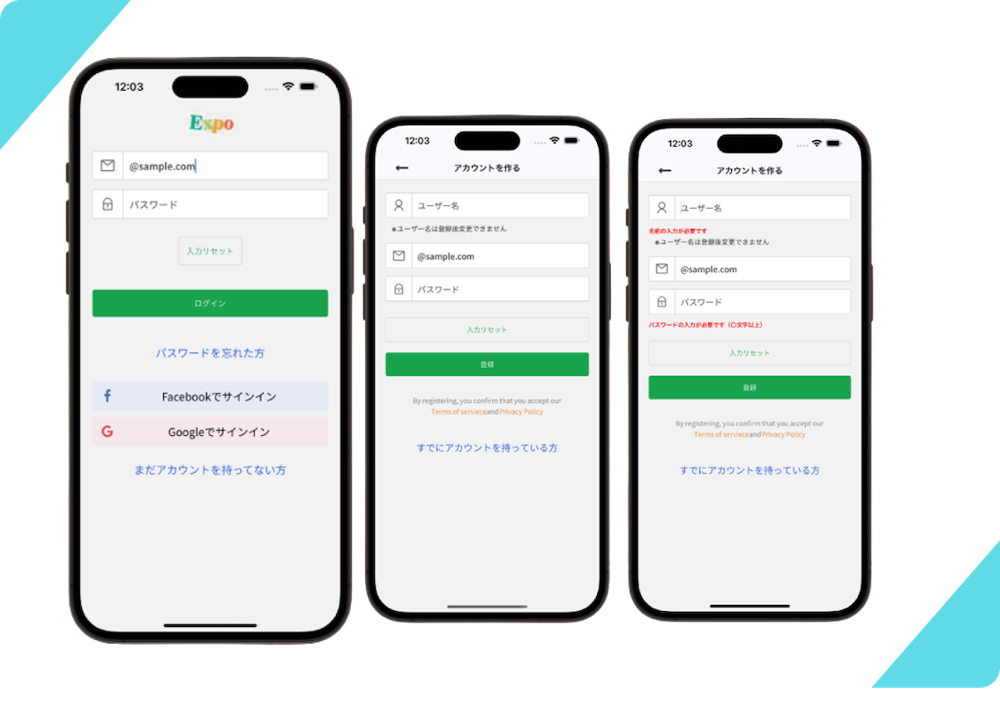

---

## コミットメッセージ規約

| 記号 | 意味 |
|------|------|
| :white_check_mark: | 小さな修正など完了、特にエラーなし |
| :wrench: | 修正中 / 作業中 |
| :tada: | 大きめの修正完了 |

## Warnings

高さに問題がある場合、以下の出力結果が `0` になっている可能性がある。

```js
console.log(Constants.statusBarHeight);
```

その場合はリロードすると解消する。

---

## ブランチごとの開発ログ

### main

メインブランチ。

### dev

日常的な作業用ブランチ。

### v1

NativeBase docs から作られたアプリに ESLint と Prettier を加えただけの素の状態。

### v2

デザイン部分完了（Firebase、Redux 追加前）。

### v3

Firebase の Authentication 部分を実装（SignupPage、LogoutPage、LoginPage）。

### v3.1

引き続き Firebase での実装（途中まで）。

すべてを Firebase ベースで実装しようとしたが、Redux で管理をしたくなったので途中で v4 に切り替えた。随時 v3 ブランチに戻って Firebase での実装を進める可能性あり。

### v4

Redux と Firebase と useContext で実装。

- SearchPage は保留。

### v4.1

- Delete 機能追加
- Reload 機能追加


### v4.2

- ログイン / サインアップの機能改良
- デザインを更新
- イベントページ追加

など。

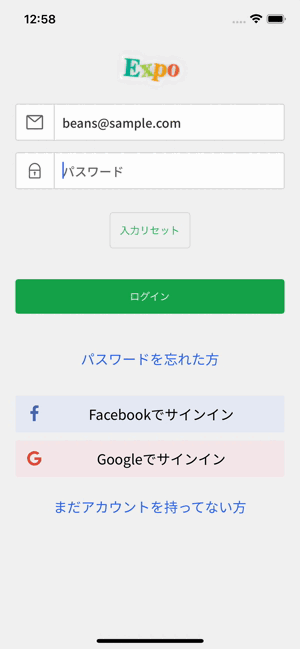

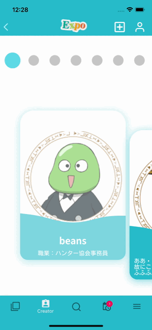
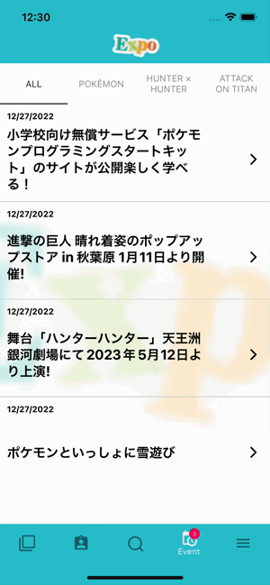

### v4.3

#### レンダリング問題の解決

**修正前:**

期待通りにレンダリングされない。この例では hisoka のページに移っても hisoka のデータを使って再レンダリングされていなかった。手動で更新すると強制レンダリングされるので期待通りにはなる。


**修正後:**

`useState` を使用し Firebase から fetch してきたデータを一旦ストアさせ、そのストアデータを使うことで毎回 state が変わるたびにレンダリングが走るようにした。

`Profile.tsx` から一部抜粋:

```jsx
const POSTS = useAppSelector((state) =>
  selectPostsByCreator(state, item.creatorId)
);

const [posts, setPosts] = useState<Post[]>([]);

useEffect(() => {
  dispatch(fetchAllPosts());
  setPosts(POSTS);
}, [dispatch]); // ここで dependencies に POSTS を加えてしまうとレンダリングが永遠繰り返されてしまう
```

上記のようにすることで POSTS が変わるたびに（state が変わり）毎回レンダリングが走るので期待通りデータが更新されるようになった。


しかしパフォーマンスに難あり。以下のように useEffect が最低3回走る。不必要なレンダリングがちょくちょく起こるため実用には不向き。

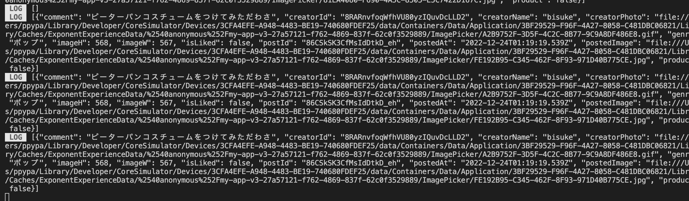

**補足:**

> Generally speaking, using setState inside useEffect will create an infinite loop that most likely you don't want to cause. There are a couple of exceptions to that rule which I will get into later.
> useEffect is called after each render and when `setState` is used inside of it, it will cause the component to re-render which will call `useEffect` and so on and so on.
> One of the popular cases that using `useState` inside of `useEffect` will not cause an infinite loop is when you pass an empty array as a second argument to `useEffect` like `useEffect(() => {....}, [])` which means that the effect function should be called once: after the first mount/render only. This is used widely when you're doing data fetching in a component and you want to save the request data in the component's state.[^1]

以下のように書き換えることで解決:

```jsx
useEffect(() => {
  dispatch(fetchAllPosts());
  // setPosts(POSTS);
}, [dispatch]);

useEffect(() => {
  setPosts(POSTS);
}, []); // 第二引数が empty だったら無限ループは回避できる
```

### v4.4

- AddPostPage.tsx ページの改良
- 選択した画像のサイズに合わせてプレビューの表示サイズを変えられるようにした
- その他アップデート機能の修正 / 改良

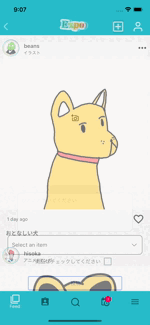

#### パフォーマンス最適化

以下の警告への対応:

> VirtualizedList: You have a large list that is slow to update - make sure your renderItem function renders components that follow React performance best practices like PureComponent, shouldComponentUpdate, etc. {"contentLength": 2074.666748046875, "dt": 844341, "prevDt": 1603}

#### DropDownPicker の自作

`AddPostPage.tsx` にて利便性から画面全体に `<ScrollView>` を使っているが、ジャンル選択時に使用しているパッケージ `DropDownPicker` を使うと以下のエラーが出る:

> VirtualizedLists should never be nested inside plain ScrollViews with the same orientation because it can break windowing and other functionality - use another VirtualizedList-backed container instead.

そのため VirtualizedList を使用しない DropDownPicker を自作して使用することにした。

#### Search 機能の追加

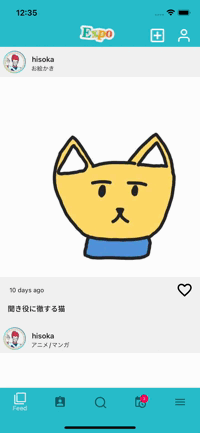

[^1]: https://stackoverflow.com/questions/53715465/can-i-set-state-inside-a-useeffect-hook
